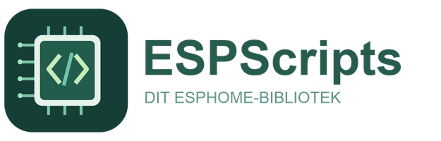

# ESPScripts



Et dansk bibliotek i Home Assistant til ESPHome YAML: find og genbrug sensorblokke og komplette ESP32-opsætninger med tilslutninger, testnoter og versionshistorik.

## Installation i Home Assistant

Kræver Home Assistant OS eller en installation med Supervisor. Understøtter amd64 og aarch64.

1. Åbn **Indstillinger → Apps → Appbutik** (på ældre HA-versioner hedder det Tilføjelser).
2. Åbn menuen **⋮ → Repositories**, og tilføj:

   `https://github.com/JRJenZens/ESPScripts`

3. Opdatér appbutikken, find **ESPScripts**, og vælg **Installér**. Første installation bygger containeren og kan tage nogle minutter.
4. Start appen, slå **Vis i sidepanelet** til, og vælg **Åbn webbrugerflade**.

[Åbn tilføjelse af repository i Home Assistant](https://my.home-assistant.io/redirect/supervisor_addon_repository/?repository_url=https%3A%2F%2Fgithub.com%2FJRJenZens%2FESPScripts)

Appen bruger Home Assistants Ingress og login. Ingen separat port eller adgangskode skal konfigureres. Biblioteket er fælles for HA-administratorer med adgang til appen; det har ikke separate brugerbiblioteker.

## Nyt i 0.3.0: import fra produktlink

Vælg **Fra produktlink** på forsiden eller under Boards/Sensorer:

1. Indsæt et offentligt HTTPS-link til en produkt- eller dokumentationsside.
2. Vælg **Hent forslag fra link**. Appen foreslår navn, hardwaretype, chipfamilie/tilslutning, beskrivelse og dokumentationslink.
3. Kontrollér og ret oplysningerne, og vælg **Gem i kataloget**. Først her gemmes posten lokalt, og den kommer med i backup.

Der skelnes mellem **ESP32-board**, **udvidelsesboard/shield**, **sensor/sensormodul** og **andet board**. Udvidelsesboards gemmes under Boards og kan tilføjes som moduler i en opsætning sammen med et separat ESP32-board. De er også tilgængelige i sensorvælgeren. De vælges ikke som selve ESP32-boardet.

Eksempler, afprøvet med de rigtige sider:

- [24GHz mmWave for XIAO](https://wiki.seeedstudio.com/mmwave_for_xiao/): foreslås som et udvidelsesboard med UART. Der gættes ikke på et ESP32-board-ID.
- [Seeed Studio XIAO ESP32C3](https://wiki.seeedstudio.com/XIAO_ESP32C3_Getting_Started/): foreslås som et ESP32-C3-board. Importen finder også det eksisterende katalogmatch, hvorfra board-ID og ESPHome-metadata kan genbruges.

Når en model allerede findes, vises et match: vælg **Vis eksisterende model** eller gem en egen udgave med et særskilt navn. Importerede ESP32-metadata kan derefter bruges til at foreslå chipvarianten i Standardprint.

Importen bruger sidens titel, metadata og tekst til at lave et **forslag**, ikke en komplet teknisk specifikation. Board-ID og komponent-ID udfyldes kun ved et eksisterende katalogmatch; ukendte komponenter skal angives manuelt. Importen henter ikke produktbilleder, pinouts, YAML eller de sider, der linkes til. Sidens tekst behandles som data. ESPHome-understøttelse og fysisk test bekræftes ikke af en produktimport.

Sider, der kræver login, JavaScript, botkontrol eller særlige browsercookies, kan ikke altid importeres. Brug i så fald **Tilføj eget board/sensor**. Der understøttes offentlige HTTPS-sider på port 443, højst 1,5 MB, med begrænset svartid og viderestillinger; lokale/private netværksadresser og PDF-filer accepteres ikke. Appen sender ikke HA-token, cookies eller bibliotekets indhold til produktsiden.

Opdatér til **0.3.0** fra HA-appbutikken. Eksisterende data bevares, og backupformat 1 og 2 er fortsat understøttet. Tag backup før opdatering.

## Nyt i 0.2.0

- Grafisk værkstedsoversigt, hardwarekort og et guidet oprettelsesforløb med Hardware → YAML → Test og noter.
- 211 boards og 200 sensorkomponenter i et indbygget katalog, som også virker uden internet. Søg på model, chipfamilie og komponent, og filtrér på familie, tilslutning eller egne tilføjelser.
- Tilføj og redigér egne boards og sensorer. De gemmes lokalt og medtages i JSON-backup.
- Vælg et board og flere sensorer, når du opretter en opsætning. Hardwarevalg organiserer opsætningen; de indsætter ikke automatisk sensorkode eller GPIO.
- Standardprint med COMMON, fælles pakker, WireGuard og hardware. Tilpas enhedsnavn og secret-prefix til nye print, og gem egne grundskabeloner med historik.
- Eget ikon og logo i HA-appbutikken og et layout til både computer og mobil.

## Standardprint

Åbn **Standardprint → Brug standardprint**. Indtast fx `esp32-019`, og vælg chip og flashstørrelse. Standardvalget er ESP32-C3, 4 MB og ESP-IDF. Generatoren laver automatisk visningsnavnet `ESP32-019` og prefixet `esp32_019`, medmindre du selv angiver andre værdier.

Grundskabelonen indeholder:

- `device_name` og `device_friendly_name`.
- `device_secret: !secret "<prefix>_secret"` til din fælles opsætning.
- `wg_private_key: !secret "<prefix>_wg_secret"` og `wg_address: !secret "<prefix>_wg_address"`.
- `base: !include common/base.yaml` og `wireguard: !include common/wireguard.yaml`.
- `esp32` med variant, flashstørrelse og ESP-IDF samt et afsluttende `logger:`-afsnit.

De fælles pakkefiler og secret-værdier skal allerede findes i ESPHome. ESPScripts læser eller opretter dem ikke og installerer ikke firmware.

Vælg **Tilpas som egen** for at redigere grundskabelonen og gemme et eget standardprint. De understøttede pladsholdere er `{{device_name}}`, `{{friendly_name}}`, `{{secret_prefix}}`, `{{variant}}` og `{{flash_size}}`; behold dobbelte anførselstegn omkring dem som i den indbyggede skabelon. `{{device_name}}` kræves for at bruge generatoren. Kun pladsholdere erstattes; faste værdier i en egen skabelon ændres ikke. De nye enheder starter med status **Ikke testet**.

Under **Ny opsætning → Hardware → Start fra standardprint** kan du også indsætte den indbyggede grundskabelon i en kladde. Har du valgt et kendt katalogboard, foreslås chipvarianten fra dets metadata; kontrollér selv flashstørrelsen. Eksisterende YAML erstattes kun efter bekræftelse.

## Hardwarekatalog

Standardkataloget ligger i [`espscripts/catalog.json`](espscripts/catalog.json) i dette repository. Det er et udvalgt snapshot fra ESPHome-kataloget via HA den 13. november 2026, ikke en komplet eller løbende synkroniseret oversigt. Board- og sensorillustrationerne er generiske symboler, ikke produktspecifikke billeder eller pinout-tegninger. Komponenternes dokumentationslinks er vedlagt i kataloget.

Egne modeller tilføjes under **Boards** eller **Sensorer** med navn, familie/tilslutning, board-ID/komponent og eventuelt et HTTPS-link. Standardkataloget følger appopdateringer; egne tilføjelser ligger i den vedvarende database. Katalogposter bekræfter ikke, at en kombination er fysisk testet. Teststatus ligger på dine opsætninger.

## Opdatering fra 0.1.0

Tag backup, genindlæs appbutikken, og opdatér ESPScripts til 0.2.0. Den eksisterende database og opsætninger bevares; katalogtabellen oprettes automatisk. Gamle JSON-backupfiler kan stadig importeres. Nye backupfiler anvender formatversion 2 og indeholder egne katalogposter; katalogposter med samme navn og type som eksisterende poster springes over ved import.

Ikon og logo er med i appmappen som `icon.png` og `logo.png`, jf. [HA's vejledning](https://contributors.home-assistant.io/apps/guides/presentation/). Hvis appbutikken viser det gamle ikon, genindlæs repository og siden. Sidepanelet bruger fortsat HA's `mdi:chip`-ikon.

## Funktioner

- Opret og redigér komplette opsætninger og genbrugelige sensorblokke.
- Søg i navn, board, sensorer, tags, GPIO/tilslutninger, noter og YAML.
- Filtrér efter board, sensor, type og teststatus.
- Notér testet hardware/dato og ESPHome-version.
- Importér en `.yaml`/`.yml`-fil, kopiér kode, eller download YAML.
- Hver gemning opretter en revision med både kode og metadata.
- Se tidligere revisioner, og indlæs dem i editoren. Gem for at gendanne som en **ny** version; eksisterende historik bevares.
- Gem som kopi opretter en ny opsætning med status **Ikke testet**.
- Eksportér hele biblioteket inklusive historik som JSON-backup. Import opretter nye kopier og bevarer historik og versionsdatoer; den overskriver aldrig eksisterende opsætninger.
- Samtidige ændringer kontrolleres, så en gammel editor ikke overskriver en nyere version.

## Arbejdsgang

Start med **Importér YAML** fra en konfiguration, du allerede har. Angiv board, sensorer og ledningsføring, og vælg om koden er en sensorblok eller en komplet opsætning. Angiv **Testet** først efter en fysisk test, og skriv hardware og dato i testfeltet.

Når du genbruger en opsætning, vælg **Gem som kopi**, tilpas navn, GPIO og øvrige værdier, og kopiér eller hent YAML til ESPHome Device Builder. En sensorblok kan indsættes i din konfiguration eller gemmes som en ESPHome-pakkefil. Biblioteket sammensætter ikke automatisk flere YAML-blokke.

**Syntakskontrol er ikke ESPHome-validering.** ESPScripts kontrollerer, at YAML kan læses som en mapping, og understøtter ESPHome-tags som `!secret`, `!include` og `!lambda`. Koden køres ikke. Board-understøttelse, komponenter, GPIO-konflikter og elektriske forhold skal kontrolleres i ESPHome og på hardwaren. YAML-ankre og aliaser understøttes ikke.

## Data og backup

SQLite-databasen gemmes i appens vedvarende `/data/espscripts.sqlite3` og indgår i en HA-backup, **når ESPScripts er valgt med i backupen**. Tag desuden JSON-backup fra biblioteket før større ændringer. JSON-import har en grænse på 32 MiB; YAML-import 500 kB. Biblioteket er tomt ved første start.

Brug `!secret`-referencer; gem ikke `secrets.yaml`, rigtige Wi-Fi-adgangskoder eller API-nøgler i biblioteket. JSON-backup indeholder hele bibliotekets indhold og skal opbevares derefter. Der er ingen cloudsynkronisering eller upload af biblioteket til GitHub. Linkimport kontakter kun den angivne offentlige produktside og dens eventuelle offentlige HTTPS-viderestillinger. GitHub indeholder kun appens kildekode.

## Manuel installation

Pak ZIP-filen ud. Kopiér mappen `espscripts` (den med `config.yaml` og `Dockerfile`) til `/addons/espscripts` på HA via en adgang, der kan skrive i den lokale apps-mappe. Genindlæs appbutikken, og installér ESPScripts under **Lokale apps**. En ZIP uploades ikke direkte til HACS eller appbutikken. GitHub-repository-metoden ovenfor er normalt nemmest.

## Lokal udvikling

```sh
python3 -m venv .venv
.venv/bin/pip install -r espscripts/requirements.txt
.venv/bin/python -m unittest discover -s tests -v
ESPSCRIPTS_LOCAL=1 ESPSCRIPTS_DB=./library.sqlite3 .venv/bin/python espscripts/app.py
```

Åbn `http://127.0.0.1:8099`. `ESPSCRIPTS_LOCAL=1` er kun til lokal udvikling: produktionsappen tillader kun Ingress-proxyen på `172.30.32.2`, og appens konfiguration eksponerer ingen værtsport.

De lokale tests dækker lagring, versionshistorik, backup, YAML-kontrol, adgangskontrol og samtidige ændringer. Browserkontrol dækker oprettelse, hardwarevalg, katalogtilføjelser, søgning og standardprint-generatoren, inklusive lagring og egne skabeloner. Linkimport og gemning er afprøvet i browseren med begge Seeed-links, inklusive eksisterende katalogmatch og udvidelsesboard som modul. Mobil- og desktoplayout er visuelt kontrolleret. Docker er ikke tilgængelig i udviklingsmiljøet, så containerbygning, installation og Ingress skal afprøves på en rigtig HA-installation. GitHub-workflows er ikke aktiveret i denne udgave.

## Dokumentation

- [Home Assistant: Ingress](https://contributors.home-assistant.io/apps/guides/ingress/)
- [Home Assistant: appkonfiguration](https://contributors.home-assistant.io/apps/reference/configuration/)

Licens: MIT.
